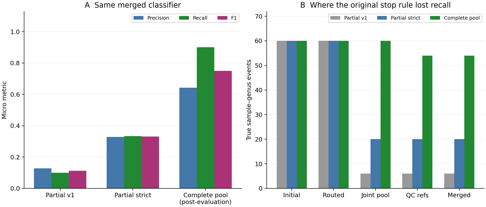

# Hierarchical genus search: ten in-silico mixtures on TTU

Best observed fixed final rule after the complete-pool correction: **auxiliary**, precision **77.1%**, recall **90.0%**, F1 **0.831** (54 TP, 16 FP, 6 FN; 1/10 exact genus sets). [Download the recommended genus set](recommended_predictions.csv) or [one text list per mixture](recommended_sets.zip).

**Development scope:** two ten-mixture baselines were frozen, predicted, audited and sealed before genus truth was opened. Their evaluation exposed a stopping-rule defect. The complete-pool correction and the recommendation above use the same ten mixtures after that evaluation; they are in-sample development results, not a new blind or independent validation. The genus model, its 0.83 threshold, QC, alignment and final-rule thresholds were unchanged.

## What worked and what failed

Both searches retained **all 60 true sample–genus events through every routing round**. The stricter policy removed a median 91.6% of the initial genus pool. Central Kew representatives and repeated independent-gene support provided useful narrowing.

The initial final stage tested only locally resolved small cells when more than 64 genera remained. That excluded 54 true events in v1 and 40 in strict routing; query fragments from those untested genera could then match related substitutes. The low end-to-end recall was caused by this final-panel fallback, rather than loss of the true genera during routing.

The correction keeps the exact frozen strict candidate lists and jointly verifies every retained genus when the pool is at most 512. The largest pool here is 447 genera. Five existing complete-pool final tests are reused; five partial tests are completed. No expected genera are added, no individual predictions are edited using truth, and mixture component counts never cap the answer.

| Same merged final classifier | TP | FP | FN | Precision | Recall | F1 | Median retained genera |
| --- | ---: | ---: | ---: | ---: | ---: | ---: | ---: |
| v1 | 6 | 41 | 54 | 12.8% | 10.0% | 0.112 | 381 |
| strict_route | 20 | 41 | 40 | 32.8% | 33.3% | 0.331 | 74.5 |
| complete_joint | 54 | 30 | 6 | 64.3% | 90.0% | 0.750 | 74.5 |

## Completed-pool method comparison

| Fixed rule | TP | FP | FN | Precision | Recall | F1 | Exact sets |
| --- | ---: | ---: | ---: | ---: | ---: | ---: | ---: |
| merged | 54 | 30 | 6 | 64.3% | 90.0% | 0.750 | 0/10 |
| c_style | 54 | 141 | 6 | 27.7% | 90.0% | 0.424 | 0/10 |
| balanced_z | 31 | 239 | 29 | 11.5% | 51.7% | 0.188 | 0/10 |
| standalone_ml | 54 | 20 | 6 | 73.0% | 90.0% | 0.806 | 0/10 |
| core | 54 | 28 | 6 | 65.9% | 90.0% | 0.761 | 0/10 |
| auxiliary | 54 | 16 | 6 | 77.1% | 90.0% | 0.831 | 1/10 |
| review | 0 | 221 | 60 | 0.0% | 0.0% | 0.000 | 0/10 |
| nearest_gene3 | 54 | 226 | 6 | 19.3% | 90.0% | 0.318 | 0/10 |
| ml_diagnostic_gene3 | 54 | 20 | 6 | 73.0% | 90.0% | 0.806 | 0/10 |

The merged rule remains the original primary comparison. Review is a separate follow-up set. The recommendation compares every fixed positive-call path, including core and auxiliary component paths, and the matched diagnostics. Including auxiliary in this choice was decided after inspecting these results. The complete output of one rule is used for every mixture; no genus-specific edits or truth-based top-N truncation are applied. This observed-F1 choice adds development selection bias.

The auxiliary path requires a C-style selected call, gene rescue, a Monte Carlo stability lower bound >0.5, and at least one ML-supported gene. It is narrower than the original core-or-auxiliary union. Its stability score is not a calibrated biological presence probability.

The nearest_gene3 control uses exactly the same pre-verifier nearest candidates and three-gene quorum as standalone ML. Replaying its accepted fragments must reproduce the sealed ML set. This diagnostic was added after the baseline evaluations, before inspecting complete-pool metrics; its prediction constructor does not read truth. It separates the verifier effect from sampling and reference coverage.

The ml_diagnostic_gene3 diagnostic additionally requires three genes with a unique nearest genus and sibling-relative margin ≥0.1, using the existing C-style diagnostic-gene evidence. Its quorum and margin were fixed before complete-pool scores were inspected, after the baseline evaluations. It addresses ambiguous conserved fragments and is eligible only as a disclosed development choice.

At the same 54 recovered events and three-gene quorum, the matched nearest-distance control produces 226 false positives, versus 20 with the learned verifier. Adding the three-diagnostic-gene condition does not change the standalone ML calls in this cohort. This supports a verifier benefit on these frozen panels; it does not isolate the sampler effect from all other pipeline changes.

## Remaining errors

All six merged false negatives first fail final-reference coverage, rather than routing or the final classifier: Gynostemma occurs in three missed events with a best checked reference of 11 accepted target loci, and Agropyropsis in three with 19. Both fall below the fixed 30-locus reference gate. The [coverage audit](REFERENCE_COVERAGE_DIAGNOSIS.json) records the source QC hashes and accepted locus counts. No coverage threshold was lowered using these known misses.

The recommended set still has 16 false positives and only one of ten mixtures has an exact genus set. Treat it as a candidate-screening result. A future generic low-coverage reference tier and any stronger false-positive filter should be fixed before testing a fresh held-out mixture cohort.

## Data, time and limitations

The cohort contains four 3-component, three 6-component and three 10-component mixtures, selected by sample-ID hashes from the completed 100-mixture dataset. They represent 19 distinct source genera and 60 sample–genus presence events. Reused assemblies cover 50 target genes. Search parents come from existing raw Z, merged and review family evidence. Target-locus QC requires at least 30 accepted genes; up to two species represent each final genus. Unavailable genera stay explicit and count as misses.

Kew planning distances count topology edges because the supplied tree has no branch lengths. Each coarse round builds fresh exon trees against reduced references. The stricter policy uses five routing genes and one nearby-genus guard, with 32 initial cells and 64 after stagnation. Final genus features use full patristic distance profiles and a separately reference-trained verifier.

Reference projection is a substantial runtime cost. Completion reuses only hashed, QC-passing fixed-coordinate references and caches negative QC checks. New references receive the same QC. Completion timings include both the reused strict pipeline and the incremental joint work, including the already-spent partial final run. Incremental times and reused-final flags are reported separately. These warm-cache observations do not establish speedup against a matched exhaustive genus run. Queueing, audit and Slurm overhead are separate from inference phases.

The final panels can contain the source species; this is a closed-reference experiment. Mixture genera were not required to be absent from model fitting. The model was fitted without mixture labels, but the cohort and reference library have been used in previous work. Results do not establish accuracy on new species, new mixtures, absent-reference genera, negative-only samples, species-level presence or abundance.

Truth is the first word of Table S1 scientific names, using source IDs in the fixed mixture IDs. All used A/B/H cells agree between openpyxl and independent ZIP/XML reads; raw method text lists independently reproduce TP/FP/FN. Source family annotations for IDs 1 and 25 have known discrepancies, but no genus substitutions are made. All 60 expected genera were already in the initial pools.

## Files

- [Complete-pool correction: per-sample results, timing and QC](complete_joint/REPORT.md)
- [Original strict policy](strict_route/REPORT.md) and [v1](v1/REPORT.md)
- [Original two-policy comparison](BASELINE_COMPARISON.md)
- [All variant and method scores](all_variant_summary.csv)
- [Recommended whole-rule selection record](RECOMMENDATION.json)
- [Recommended per-sample accuracy and error lists](recommended_by_sample.csv)
- [Source/model/routing reuse audit](COMPLETION_COMPARISON_AUDIT.json)
- [Shared trained genus model](shared_model/model.joblib)
- [Post-evaluation correction plan](../../POSTHOC_COMPLETION_PLAN.md)

All source payloads, job records, hash audits and raw compact results are in artifacts/. The original workbook and DNA read data are not redistributed. Branch: `experiment/adaptive-genus-search-20261017`; production defaults and previous family results are unchanged.
