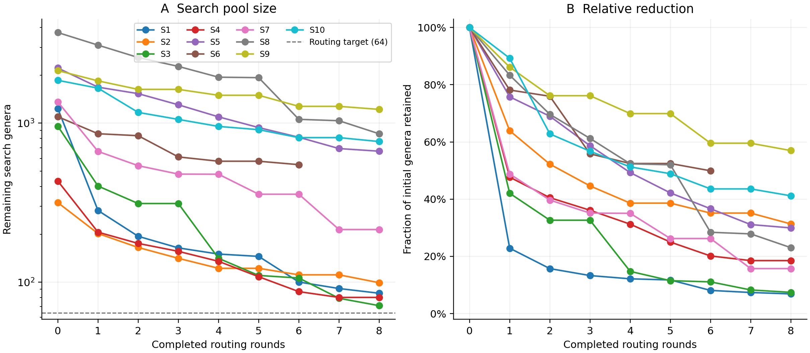
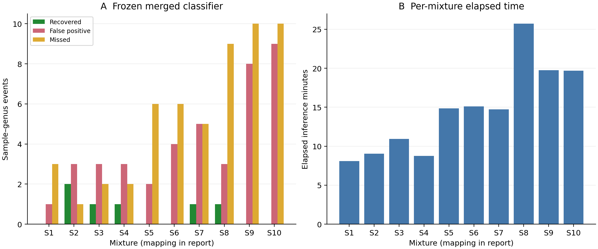
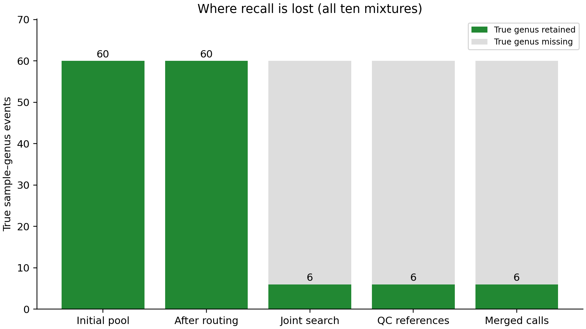

# Ten in-silico mixtures: adaptive phylogenetic genus search

All ten TTU pipelines completed and passed frozen input/model/code/product checks. The predeclared merged genus method recovered 6 true sample–genus events, with 41 false positives and 54 missed events: precision **12.8%**, recall **10.0%**, F1 **0.112**.

The search removed a median 73.5% of the initial recoverable genus pool. 0/10 searches reached the ≤64-genus search target. 0/10 searches reached a fully QC-represented final joint panel; 10/10 retained explicit unresolved regions or final reference omissions. Per-mixture elapsed inference was 8.1–25.7 minutes (median 14.8); shared reference-only model training took 5.9 minutes.

This is a retrospective method experiment on ten mixtures from the previously analyzed 100. The 4/3/3 selection across 3-, 6- and 10-component strata was fixed by sample-ID hashes, without genus truth or prior success scores. It is not an independent biological validation. Mixture component counts never determine the number of predicted genera.

This batch was frozen and sealed before its genus truth was opened. It remains retrospective development on previously analyzed mixtures.

## Search behavior

The existing family search parents are the union of raw Z, frozen merged and review families. Inside those parents, partition the recoverable Kew tree into 32 neighborhoods, subdivide each into representative regions, and choose central genera using genus-balanced minimax/mean distance to a farthest-point landmark cover. The supplied Kew tree has no branch lengths; these planning distances count topology edges, not evolutionary time. All recoverable placements of polyphyletic genera remain eligible.

Representative sequences must pass MrKnowItAll QC on at least 30 of the actual 50 target genes. Download only proposed recoveries, replace failed representatives locally, and preserve uncovered regions as unresolved. Cache QC and projected reference coordinates per sample. At each round, align the existing query exons to the reduced panel and build fresh full exon trees. 2 independent genes retain a region; a close second route needs 3 genes. Nearby guards add 4 genera per supported anchor, within the previous active pool. The anchor genus labels its region until the final joint test.

Repartition and repeat. A stalled round permits 64 cells; two consecutive ≥95% retention rounds or eight total rounds stop routing. At ≤64 surviving genera, jointly test up to two QC-passing species per genus. Larger unresolved searches can test fully local neighborhoods while retaining other genera as unresolved. This partial fallback was subsequently diagnosed as a stopping-rule defect. No biological top-N prediction cap is used.

| ID | Mixture | Search genera: initial → retained | Final tested genera / species | Rounds | Minutes | Status | TP / FP / FN |
| --- | --- | ---: | ---: | ---: | ---: | --- | ---: |
| S1 | 07x26x30 | 1234 → 85 | 20 / 24 | 8 | 8.1 | unresolved_partial | 0 / 1 / 3 |
| S2 | 18x25x12 | 316 → 99 | 43 / 58 | 8 | 9.0 | unresolved_partial | 2 / 3 / 1 |
| S3 | 30x04x03 | 956 → 71 | 23 / 28 | 8 | 10.9 | unresolved_partial | 1 / 3 / 2 |
| S4 | 26x01x24 | 432 → 80 | 29 / 39 | 8 | 8.8 | unresolved_partial | 1 / 3 / 2 |
| S5 | 30x04x19x07x03x16 | 2224 → 666 | 8 / 11 | 8 | 14.9 | unresolved_partial | 0 / 2 / 6 |
| S6 | 30x04x13x26x19x28 | 1098 → 548 | 26 / 37 | 6 | 15.1 | unresolved_partial | 0 / 4 / 6 |
| S7 | 04x07x08x15x16x01 | 1361 → 214 | 17 / 19 | 8 | 14.7 | unresolved_partial | 1 / 5 / 5 |
| S8 | 04x30x25x16x10x03x28x01x13x08 | 3719 → 857 | 19 / 23 | 8 | 25.7 | unresolved_partial | 1 / 3 / 9 |
| S9 | 25x28x30x07x22x24x12x04x03x18 | 2143 → 1221 | 28 / 41 | 8 | 19.7 | unresolved_partial | 0 / 8 / 10 |
| S10 | 07x22x30x08x18x13x03x19x04x02 | 1861 → 766 | 23 / 30 | 8 | 19.7 | unresolved_partial | 0 / 9 / 10 |

Across 78 routing rounds, median per-round reduction was 11.8%. Full per-round panels, counts, evidence, QC and timing are in the sealed batch archive and rounds.csv. The pilot and training costs are separate from the ten sample times. Slurm used eight CPUs per mixture with up to 4 mixtures of this phase concurrently; the strict-policy throttle increased from two to four to six as earlier work finished. Reported inference times exclude queueing, prior assembly, initial/final audits and Slurm setup/cleanup. Allocated job elapsed times are recorded separately in Slurm accounting. Fetch/QC/alignment durations overlap worker tasks and are not CPU-time totals.

Reference-count reduction measures avoided reference work. There is no exhaustive genus run on these same ten samples, so these results do not establish a measured speedup over the old pipeline. The previous progressive ten-mixture cohort differs from this cohort.

| Runtime phase | Median seconds per mixture | Sum of sample-phase minutes |
| --- | ---: | ---: |
| fetch_parse | 7.4 | 1.4 |
| reference_QC | 62.0 | 9.4 |
| reference_projection | 493.8 | 84.4 |
| query_align_tree | 178.4 | 32.6 |
| planning_routing_scoring_other | 117.4 | 18.9 |

Phase sums combine overlapping Slurm tasks and are not cohort wall time or CPU time. The residual phase includes tree planning, index loading, routing and final scoring.

## Genus predictions

Primary output: [merged_predictions.csv](merged_predictions.csv). The [complete method sets](prediction_sets.zip), [candidate evidence](candidate_evidence.csv) and [unresolved search regions](search_regions.csv) are separate exports.

| Method | TP | FP | FN | Precision | Recall | F1 | Exact sets |
| --- | ---: | ---: | ---: | ---: | ---: | ---: | ---: |
| merged | 6 | 41 | 54 | 12.8% | 10.0% | 0.112 | 0/10 |
| c_style | 6 | 76 | 54 | 7.3% | 10.0% | 0.085 | 0/10 |
| balanced_z | 5 | 48 | 55 | 9.4% | 8.3% | 0.088 | 0/10 |
| standalone_ml | 6 | 15 | 54 | 28.6% | 10.0% | 0.148 | 0/10 |
| core | 6 | 22 | 54 | 21.4% | 10.0% | 0.136 | 0/10 |
| auxiliary | 6 | 40 | 54 | 13.0% | 10.0% | 0.113 | 0/10 |
| review | 0 | 37 | 60 | 0.0% | 0.0% | 0.000 | 0/10 |

| Merged, by mixture complexity | Samples | TP | FP | FN | Precision | Recall | F1 |
| --- | ---: | ---: | ---: | ---: | ---: | ---: | ---: |
| 3 components | 4 | 4 | 10 | 8 | 28.6% | 33.3% | 0.308 |
| 6 components | 3 | 1 | 11 | 17 | 8.3% | 5.6% | 0.067 |
| 10 components | 3 | 1 | 20 | 29 | 4.8% | 3.3% | 0.039 |

Review is an unmerged follow-up set, not another primary call set. C-style uses a new genus-balanced distance contrast and the previous gene-bootstrap confirmation/rescue formulas. Merged keeps C-style calls with at least two ML-supported genes, or the predeclared stable auxiliary rescue with one ML-supported gene. Balanced Z is a within-panel standardized contrast; it is not the old raw family Z.

## Where true genera were lost

| First loss / recovery stage | Sample–genus events |
| --- | ---: |
| recovered | 6 |
| unresolved_search_region | 54 |

[truth_survival.csv](truth_survival.csv) records every true genus surviving each round; [first_losses.csv](first_losses.csv) identifies the first exclusion. All ten mixtures contribute to recall, including absent parents, unavailable references, unresolved searches and final rejections. The original Table S1 is the primary literal truth. Older family reports documented source-identity discrepancies for IDs 1 and 25; no genus substitution was inferred from these predictions.

## Model and reproducibility

The new genus verifier used 397 Kew species across 297 genera and 50 reference-only gene trees. Entire genera are partitioned for fitting, calibration and testing. Known-genus and genus-absent pseudoqueries fixed the threshold at 0.83 before mixture prediction. Reference-held-out correct known-genus acceptance was 55.6%; genus-absent rejection was 96.5%. These are reference fragment checks, not ten-mixture accuracy or biological presence probabilities. The reference library came from previously constructed panels and is not an independent library. Source species were not explicitly excluded from the final Kew panels; this is a closed-reference experiment, not a test of genus recognition for wholly unrepresented source species.

The final query workflow also changes reference-column trimming and alignment projection. Accuracy/runtime differences cannot be attributed to the sampler alone. Sparse loci and cross-genus similarity can defeat routing; unresolved regions are visible instead of forced into representative labels. Species-level presence and abundance are not evaluated.

Initial inference implementation: `1fbf38d`; truth-blinded strict policy: `3f302fb`. Later commits add local evaluation gates, report figures and artifact audits. Branch: `experiment/adaptive-genus-search-20261017`. The previous pipeline defaults and family results are unchanged. No mixture-truth-based threshold tuning was performed in this frozen experiment.

The [protocol](PROTOCOL.json), [prediction seal](PREDICTION_EXPORT.json), [independent evaluation audit](EVALUATION_AUDIT.json), [training record](model/TRAINING.json), runtime source snapshot, trained model, job records and batch archive preserve the run. The model training used its separately archived source snapshot; technical pilot failure records are retained. The original workbook and raw reads are not redistributed.

Truth source: original 30-source Table S1, SHA-256 `421cca29377ab01e57cb6aeded7bf446ba4faf06282120a4ed602e8c67bbb01f`. Every used source-ID, genus/name and family cell was checked with both openpyxl and ZIP/XML. Per-method plain text prediction files independently reproduce TP/FP/FN. The truth workbook was opened only after all ten outputs were complete, downloaded and sealed locally.
