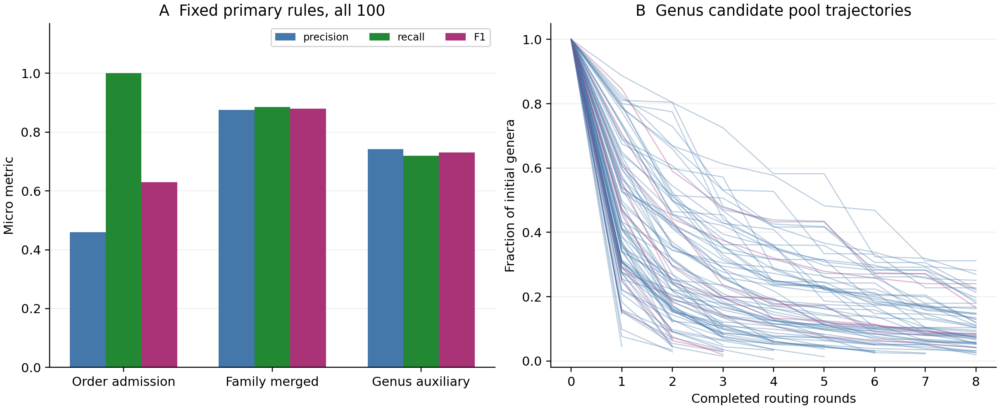

# 100-mixture fresh order-to-genus validation on TTU

All 100 samples completed fresh order/family/genus inference and source/model/input/product checks. Only query assemblies and reference resources were reused. Fixed primary rules are order admission, family merged and genus auxiliary; the best-performing rule is not reselected using this run.

| Subset | Rank / fixed rule | Samples | TP | FP | FN | Precision | Recall | F1 | Exact sets |
|---|---|---:|---:|---:|---:|---:|---:|---:|---:|
| all100 | order / admission | 100 | 475 | 559 | 0 | 45.9% | 100.0% | 0.630 | 11/100 |
| all100 | family / merged | 100 | 471 | 67 | 61 | 87.5% | 88.5% | 0.880 | 44/100 |
| all100 | genus / auxiliary | 100 | 403 | 140 | 157 | 74.2% | 72.0% | 0.731 | 11/100 |
| genus_development10 | order / admission | 10 | 47 | 67 | 0 | 41.2% | 100.0% | 0.584 | 2/10 |
| genus_development10 | family / merged | 10 | 50 | 6 | 6 | 89.3% | 89.3% | 0.893 | 5/10 |
| genus_development10 | genus / auxiliary | 10 | 54 | 16 | 6 | 77.1% | 90.0% | 0.831 | 1/10 |
| other90 | order / admission | 90 | 428 | 492 | 0 | 46.5% | 100.0% | 0.635 | 9/90 |
| other90 | family / merged | 90 | 421 | 61 | 55 | 87.3% | 88.4% | 0.879 | 39/90 |
| other90 | genus / auxiliary | 90 | 349 | 124 | 151 | 73.8% | 69.8% | 0.717 | 10/90 |

Pink trajectories are the previous ten genus-development samples; blue trajectories are the other ninety. The cohort contains 40 three-component, 40 six-component and 20 ten-component mixtures. All samples and their source species were analyzed previously. The other ninety are additional genus evaluation mixtures, not independent biological samples or unseen-source-species validation.

## Search and errors

Median within-genus-search candidate reduction: 92.4%. 1/100 final panels are fully QC represented. Missing parents, missing references and unresolved searches remain in recall denominators. The normal routing target is 64 genera and the final complete-pool limit is 512; larger pools abstain.

| First genus loss / recovery | Occurrences |
|---|---:|
| recovered | 403 |
| final_reference_QC_unavailable | 50 |
| round_02_routing_exclusion | 3 |
| unresolved_search_region | 100 |
| round_01_routing_exclusion | 3 |
| round_03_routing_exclusion | 1 |

10/100 searches finish with an unresolved final pool. The fully QC-represented count above requires a reference for every candidate genus; a missing reference for an irrelevant candidate also marks a panel as partial. This status is separate from successful computational completion.

| Genus auxiliary by mixture size | Samples | TP | FP | FN | Precision | Recall | F1 |
|---|---:|---:|---:|---:|---:|---:|---:|
| components3 | 40 | 105 | 53 | 15 | 66.5% | 87.5% | 0.755 |
| components6 | 40 | 208 | 72 | 32 | 74.3% | 86.7% | 0.800 |
| components10 | 20 | 90 | 15 | 110 | 85.7% | 45.0% | 0.590 |

Per-sample truth and all error lists are in [by_sample.csv](by_sample.csv). Every fixed alternate method and mixture-size stratum is in [summary.csv](summary.csv). Primary outputs are in [primary_predictions.csv](primary_predictions.csv). Order calls and the broad family Z/merged/review union are search admissions; a genus can be supported through a review family rather than the final family merged list. No ancestral closure or truth-based manual replacement is applied.

## Time

Fresh inference per sample: 8.62–264.75 minutes; median 65.57 minutes. This includes per-genus in-task audits. Final parent-product auditing, preparation, final collection, queueing and prior assembly are separate.

| Phase | Median minutes | Sum of sample-phase minutes |
|---|---:|---:|
| order_align_tree | 3.25 | 322.45 |
| order_distances | 0.11 | 11.73 |
| order_prediction | 0.02 | 2.69 |
| family_prefetch | 0.13 | 13.45 |
| family_uncapped_family_reference | 29.37 | 3520.89 |
| family_family_trees | 15.58 | 2135.65 |
| family_family_distances | 0.54 | 81.45 |
| family_frozen_C_and_stability | 0.09 | 10.96 |
| family_frozen_ML | 0.12 | 14.22 |
| family_complete | 0.00 | 0.08 |
| genus_adaptive_search_and_final | 15.20 | 1787.06 |

Tasks execute concurrently according to the scheduler; phase sums are not cohort wall time or CPU time. No workflow array concurrency throttle is applied. Training is not repeated. Cached Kew DNA and pretrained checkpoints make this a warm-cache benchmark. Fine genus rounds are in [genus_rounds.csv](genus_rounds.csv); QC/projection/final coverage summaries are in [genus_search_summary.csv](genus_search_summary.csv).

## Interpretation and provenance

The plan, policies and models were fixed before this inference batch. The genus auxiliary choice and complete-pool stopping correction were selected in the previous ten-mixture development. The family and genus verifier thresholds remain 0.94 and 0.83. Reference coverage remains 30 of 50 target genes for genus representatives. Source species are allowed in reference panels. Scores and selection stability are not calibrated biological presence probabilities.

Truth uses literal Table S1 source IDs, G order, H family and the first word of B scientific names. All used cells are checked with openpyxl and independent ZIP/XML. Known family-name discrepancies for source IDs 1 and 25 are retained in this literal view; genus names are not substituted. The workbook stays local and unchanged. Outputs are sealed and raw text lists checked before scoring.

Branch: `experiment/order-to-genus100-20261022`. See [PLAN.md](PLAN.md), [PROTOCOL.json](PROTOCOL.json), [PREDICTION_SEAL.json](PREDICTION_SEAL.json) and [EVALUATION_AUDIT.json](EVALUATION_AUDIT.json).
