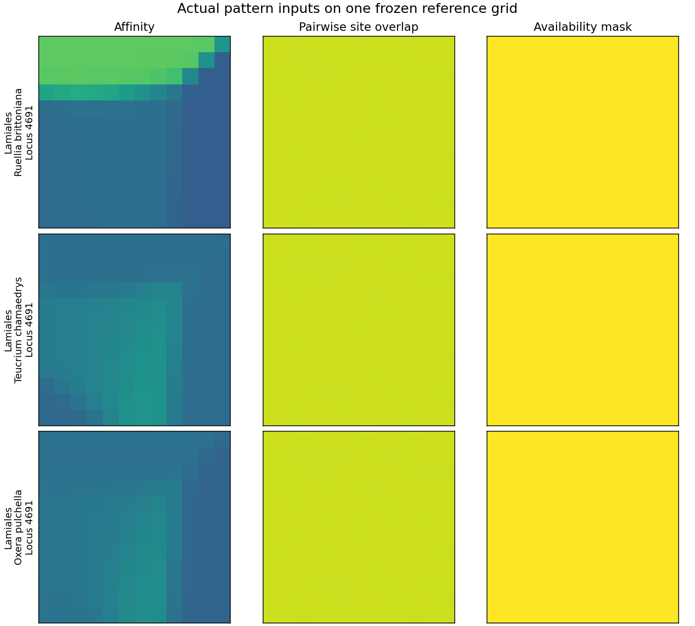
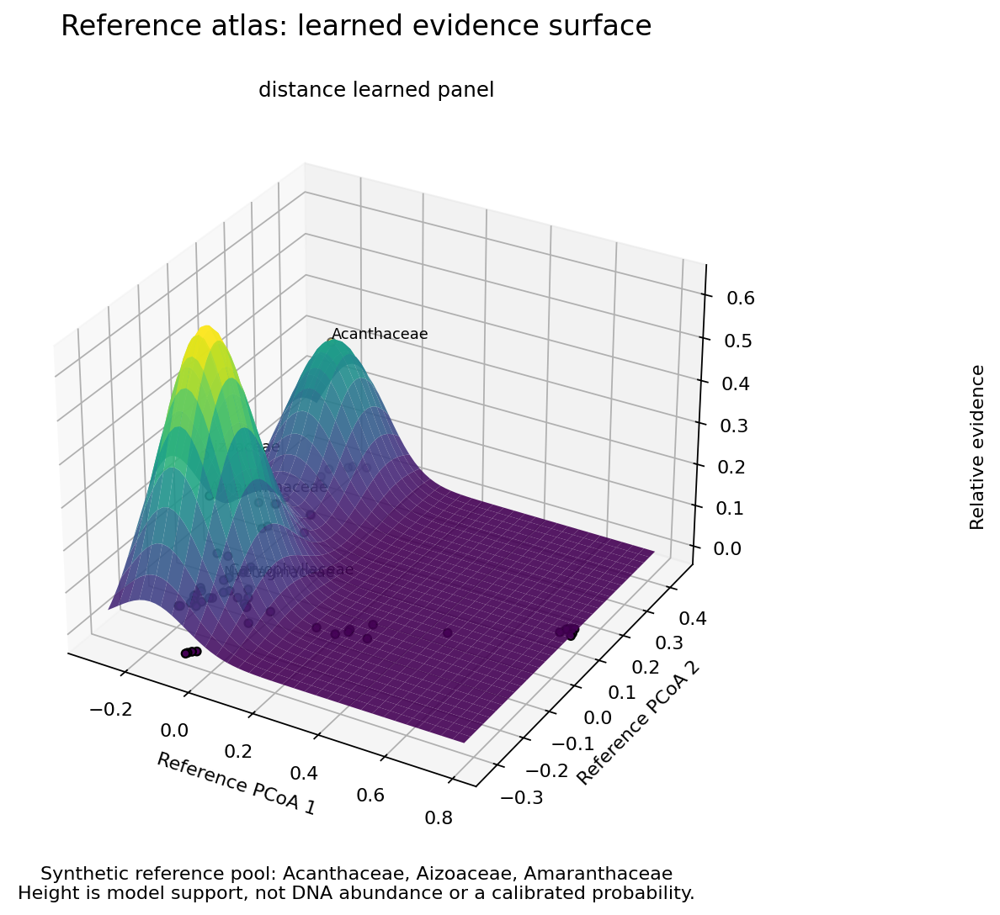

# Reference atlas 首轮实验结果

2026-10-16。代码、物种分区、参数和所有结果一同提交。
这是 reference pseudo-query 的探索性测试，不代表真实混样或精确种级鉴定性能。
三次 seed 是同一资源的重复划分，测试物种可能重复，不作为三个独立数据集推断显著性。

## 结果支持什么

完整 query-to-reference 指纹在当前数据上包含可用于高阶分类的信息。
把片段压缩成二维坐标再分类损失很大。固定地图上的三通道 pattern 能学习到信号，
但全局测试中仍弱于完整 profile。局部科级 pattern 表现较好，样本量很小，
而 nearest-reference 也很强，暂时没有证据证明深度网络或学习 panel 已解决旧问题。

MrKnowItAll 的接入使科级实验真正可运行：使用其 installer / taxonomy corrections，
从用户提供的原始 ZIP 建立独立参考库，再取 SPrOUT 相同的 50 个基因。
相关输入没有重新下载或改写现有工程，也没有把原始序列加入 Git。

## 数据与划分

| 实验 | reference identity groups | 可训练类群 | anchors 候选/选用 | 训练查询物种 | 验证物种 | 测试物种 | 未知类物种 |
| --- | ---: | ---: | ---: | ---: | ---: | ---: | ---: |
| SPrOUT 演示数据，目级 | 298 | 29 目 | 54 / 48 | 121 | 38 | 38 | 47 |
| MrKnowItAll backbone，全局科级 | 797 | 47 科 | 104 / 64 | 204 | 74 | 74 | 341 |
| MrKnowItAll，Lamiales 内科级 | 63 | 6 科 | 10 / 8 | 17 | 8 | 8 | 20 |

anchors、训练、验证、测试、未知类五部分物种互不重叠。同一 identity 的全部位点及
accession 一起分区。这里的 identity 也包括 `Genus_sp` 等保守合并的未定种名称，
并不等价于每条记录都已经完成了独立的生物学物种核验。
每个可训练类群至少四个 identity，样本不足的其他类群仅用于未知类测试。
所有测试使用 50 个 gene alignment，没有把它们冒充外显子或真实 query contig。
Lamiales 测试预先知道了正确的目，是局部模型的条件性能，尚未包含 order routing 错误。

MrKnowItAll 校正后完整资源有 353 loci、186,266 条序列、810 specimen/source entries、
797 个 summary names、59 个目和 291 个科。原始压缩包 SHA-256 为
`42b0c210961c13376c8e01f8a2673148cd4f6a330e5b7b2deca6ae51d3819931`。
builder commit 为 `c3d7df29aed81071e18b32401fd21b1d0bd541be`。
全部原始 gene FASTA、corrections、installer 的校验和在各 `metrics.json` 内。

导入时发现 genus-only `Hemerocallis_1KP-基因号` header。直接截前四段会把不同基因号
变成不同“物种”，导致评估泄漏。本实验排除了所选位点中的 49 条此类无效 identity
记录，并在 metadata 保留审计列表。此处理没有修改 MrKnowItAll 的原始代码或资源。

## 三次划分的平均表现

表内为种级留出的高阶分类 **accuracy / macro F1**。它们是未经 abstention 筛选的结果。

| 方法 | 目级 298 refs | 全局科级 MrKnowItAll | Lamiales 内科级 |
| --- | --- | --- | --- |
| 完整 profile，学习 panel | 0.8772 / 0.8089 | 0.9550 / 0.9205 | 0.9583 / 0.9704 |
| 完整 profile，分层随机 panel | 0.8947 / 0.8395 | 0.9550 / 0.9205 | 1.0000 / 1.0000 |
| 完整 profile，全候选 anchors | 0.8860 / 0.8215 | 0.9550 / 0.9205 | 1.0000 / 1.0000 |
| 固定地图 raster pattern | 0.7105 / 0.5984 | 0.8378 / 0.7681 | 0.9583 / 0.9259 |
| 二维 PCoA + logistic regression | 0.2632 / 0.1527 | 0.1757 / 0.0767 | 0.4583 / 0.4040 |
| 二维 PCoA + K-means | 0.3246 / 0.1793 | 0.2072 / 0.1096 | 0.7083 / 0.6667 |
| nearest anchor，跨位点投票 | 0.8158 / 0.6929 | 0.9459 / 0.8972 | 0.9583 / 0.9259 |

全部 63 个 method/run 数值见 [summary.csv](summary.csv)。每个种的预测见相应目录的
`predictions.csv`，五分区完整名单在 `metrics.json`。没有挑选最高 seed 作为总成绩。

全局科级完整 profile 的三次 accuracy 分别为 **90.54%、97.30%、98.65%**；
raster 为 **83.78%、78.38%、89.19%**；nearest anchor 为 **94.59%、93.24%、95.95%**。
完整 profile 与 nearest anchor 的平均差异约 0.9 个百分点，不能凭这个小测试宣称
稳定的算法优势。学习 panel、随机 panel、全部 anchors 在这三次科级测试的 top-1
结果完全相同；panel selection 的额外收益尚未得到支持。

局部科级 raster 的三次 accuracy 为 **100%、87.5%、100%**。每次只有八个测试物种，
一次错误就是 12.5 个百分点，应该把它看作可继续研究的信号，而不是完成了科级鉴定。

## 图像和固定坐标提供了什么信息

上图是 seed 42 的三个 held-out reference query 在第一个可用 gene 上的实际输入。
相似度、有效位点覆盖和可用性使用相同的冻结网格。颜色并非事后按真实标签绘制。
归一化 profile 保留 anchor 顺序，图像编码在固定空间内将这些特征平滑投射。

目级二维 PCoA 只保留约 **22.0%–22.8%** 的正特征值质量；全局科级为
**25.5%–27.9%**；Lamiales 局部地图为 **48.0%–51.9%**。
这不是分类准确率，也不表示其余信息都是噪声。
全局科级 seed 43 的 64-anchor 地图有七对距离没有共同有效位点，采用显式
anchor graph shortest-path 补全，仅用于布局。另两个 seed 和全部局部地图无需补全。
这张 seed 43 地图的负特征值质量约 5.0%，另两次小于 0.8%，必须视作几何近似。

这张地形来自预定的三个 held-out reference profile pool，真值为 Acanthaceae、
Aizoaceae、Amaranthaceae。它没有模拟测序或重新组装。
高度为相对模型支持的展示性平滑。同类群分数平均分给该类群 anchors，以免
代表多的科直接得到更高总质量。山峰可以合并，不用山峰数量估计物种数。
类别原始支持保存在相邻 `synthetic_mixture_*.json` 中。

## Unknown 是当前最直接的失败项

模型在验证集上选择的阈值，仅要求已知类 validation precision 至少 90%，
并且至少接受五个验证物种。这不等于对未知类校准过的拒识器。

全局科级学习 panel 模型对 341 个未知类物种的 false acceptance 为
**42.52%、76.54%、70.97%**；raster 为 **73.61%、42.82%、78.01%**。
即使已知科准确率较高，未知科仍很容易被强制归入已有科。
局部 Lamiales 的未知科误接收也不稳定。

本轮 unknown 来自样本不足的类群，采样结构有偏；它们只能暴露问题，不能估计
自然混样中未知物种的真实比例。需要另外留出整科/整属的 unknown validation，
校准拒识，再在从未接触的 unknown test 上验证。阈值不可在当前 unknown test 上反调。

## 这轮之后的具体方向

1. 以完整 profile 的分层随机 panel / nearest anchor 作为保留基线。
   学习 panel 需要在更低预算、独立数据集上证明收益，也要衡量特征生成速度。
2. 将 MrKnowItAll/Kew 的参考扩充用于同科跨属、同属跨种的密集训练库；
   继续保持同物种和 specimen 的整体留出。
3. 对空间 pattern 测试局部多尺度地图、多视角或监督距离学习，再与 CNN 比较。
   新的布局/模型实验需要锁定新的评估集，不能继续调这三次已查看的测试划分。
4. 加入真实 assembled exon、旁系同源、截短/缺失/错误和近缘混样，明确组装成本、
   reference 建库成本、query 距离生成成本以及模型推断时间。
5. 完成 unknown 校准后再做自动 hierarchy 和物种级识别。
   当前有独立 rank / parent-order scope，尚未完成端到端 hierarchy。

## 可重复性与验证

`README.md` 提供全部 CLI。记录运行环境为 Python 3.12.14、NumPy 2.0.2、SciPy 1.13.1、
scikit-learn 1.6.1、Matplotlib 3.9.4。每个 metrics 中的 experiment SHA-256 与提交代码一致。
大体积 NPZ 和训练模型留在 ignored `runs/`，通过相同输入和命令重建。
所有 17 个测试通过，覆盖缺失位点数值、物种分区、训练范围隔离、固定 PCoA 投影、
layout completion、pattern 顺序不变性、matrix adapter、模型保存加载与新 query 推断，
以及既有 SPrOUT-PEA 测试。
