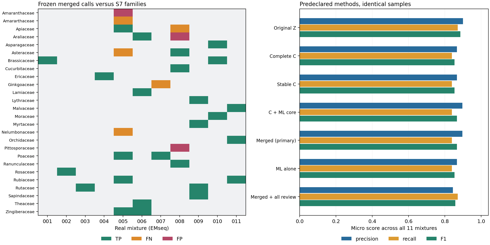

# UMD 11 个真实混样的冻结方案验证

11/11 已完成。**合并方案比完整 C 略有进步，但没有成为本批真实样品中表现最好的方案；原始 Z 的 F1 更高。** 本次只验证科的存在与否，不验证种级分辨率或丰度。

## 主结果：严格保留 S7 原表 Expected 注释

使用用户提供的 `2024Fall/CodFather(TM)/STable.xlsx`，`Table S7!B4:J67`。54 条成分记录折为 31 个“样品 × 科存在”事件，覆盖 11 份样品。按 `Library ID` 的 EM-1…EM-11 映射为 EMseq001…EMseq011。真值只来自 I/J 的 Expected Orders/Families，K/L 的旧版 Predicted 列从未作为真值。

| 方法 | TP | FP | FN | 精确率 | 召回率 | F1 | 完全匹配 |
|---|---:|---:|---:|---:|---:|---:|---:|
| 原始 Z > 0.9 | 27 | 3 | 4 | 90.0% | 87.1% | 0.8852 | 8/11 |
| 完整方案 C | 26 | 4 | 5 | 86.7% | 83.9% | 0.8525 | 8/11 |
| C + 稳定性 | 26 | 4 | 5 | 86.7% | 83.9% | 0.8525 | 8/11 |
| C + ML 核心 | 26 | 3 | 5 | 89.7% | 83.9% | 0.8667 | 8/11 |
| 合并方案（预定主方案） | 26 | 3 | 5 | 89.7% | 83.9% | 0.8667 | 8/11 |
| 单独 ML ≥3 基因 | 26 | 4 | 5 | 86.7% | 83.9% | 0.8525 | 7/11 |
| 合并 + 全部 review（诊断） | 27 | 5 | 4 | 84.4% | 87.1% | 0.8571 | 7/11 |

与完整 C 比，合并方案只删除了 EMseq008 的 **Griseliniaceae** 这 1 个误报，未损失 C 的真阳性。召回率不变，精确率从 86.7% 到 89.7%，F1 从 0.8525 到 0.8667。主方案与核心集合完全相同；辅助路径在这批样品中新增 **0** 个结果。稳定性过滤也未改变 C 的集合。

原始 Z 比合并方案多检出 EMseq008 的真实 Apiaceae，且误报集合相同，因此主评分更好。没有根据 S7 重新选择阈值、放宽门槛或替换预定主方案。不能把模拟 100 样品中的较高分数直接外推到这批真实混样。



图左仅展示真值与合并预测的科并集，绿色为 TP、橙色为 FN、红色为 FP；灰色为该样品未报且原表未列出的科。Amararthaceae 按原表拼写保留。图右比较全部预定方法。

## 独立诊断：对所有成分统一使用冻结 Kew 分类

在首次计算指标前，逐条将全部 54 条物种记录映射至冻结 MrKnowItAll/Kew taxonomy tree；全部可解析，无未解决条目。发现两处 Expected 注释与该分类不一致：

| S7 单元格 | 物种 | S7 Expected family | 冻结 Kew family |
|---|---|---|---|
| J32 | Beta vulgaris | Amararthaceae | Amaranthaceae |
| J60 | Allium sativum | Asparagaceae | Amaryllidaceae |

这不是沿用此前模拟样品的 ID 修正。所有物种统一映射，不按本次预测是否正确选择修正对象；原工作簿保持不变。原表主评分仍保留，以下仅为独立分类诊断。Allium 与同样品的 Asparagus 在原表被合并成同一科，统一分类后 EMseq010 多出一个真实科，因此真值总事件数从 31 变为 **32**。

| 方法 | TP | FP | FN | 精确率 | 召回率 | F1 | 完全匹配 |
|---|---:|---:|---:|---:|---:|---:|---:|
| 原始 Z > 0.9 | 28 | 2 | 4 | 93.3% | 87.5% | 0.9032 | 7/11 |
| 完整方案 C | 27 | 3 | 5 | 90.0% | 84.4% | 0.8710 | 7/11 |
| C + 稳定性 | 27 | 3 | 5 | 90.0% | 84.4% | 0.8710 | 7/11 |
| C + ML 核心 | 27 | 2 | 5 | 93.1% | 84.4% | 0.8852 | 7/11 |
| 合并方案（预定主方案） | 27 | 2 | 5 | 93.1% | 84.4% | 0.8852 | 7/11 |
| 单独 ML ≥3 基因 | 27 | 3 | 5 | 90.0% | 84.4% | 0.8710 | 6/11 |
| 合并 + 全部 review（诊断） | 28 | 4 | 4 | 87.5% | 87.5% | 0.8750 | 6/11 |

同一份合并预测在这份诊断下为 27 TP、2 FP、5 FN，完全匹配 7/11。它仍落后于原始 Z 的 F1 0.9032；统一分类没有消除 EMseq010 对 Amaryllidaceae 的漏检。

## 错误发生在哪里

| 样品 / 真实科 | 本次证据与结果 |
|---|---|
| EMseq005 / Asteraceae | Asterales 未进入复用证据所恢复的目候选，未构建该样品的科参考；保留为 FN。 |
| EMseq005 / Nelumbonaceae | Proteales 未进入目候选；保留为 FN。 |
| EMseq007 / Ginkgoaceae | Ginkgoales 未进入目候选；保留为 FN，未因既往“无参考”备注而删除。 |
| EMseq008 / Apiaceae | 目、科参考均覆盖，原始 Z=3.679，但仅 1 个原始最近基因支持、0 个 ML 验证基因；C 的确认门槛已将其排除，合并规则无法恢复。仍在 review 中，主评分照计 FN。 |
| EMseq010 / Amaryllidaceae（Kew 诊断） | 已有参考，3 个原始最近基因支持，但只有 1 个 ML 验证基因，C 不入选；主集合和 review 均未收录。 |

按统一分类，32 项真实科事件中，29 项进入了上游目和本样品科参考；3 项在上游已经被排除。固定当前目候选时，科级阶段的召回上限为 29/32=90.6%。不能只在参考覆盖的子集中报告总体召回率。

EMseq008 的两个实际误报为 **Araliaceae、Pittosporaceae**，分别获得 5、4 个 ML 验证基因，C 选择频率都为 1.0。这说明“多基因支持且重采样稳定”仍可能稳定地混淆同目近缘科。Apiaceae 面板的 4 个代表为 Apium graveolens、Cnidium monnieri、Daucus carota、Ammi trifoliatum；没有该样品真实成分 Centella asiatica 的属级代表。参考覆盖与距离域迁移值得下一次独立实验检查，但本次结果不能证明单一原因。

把全部 review 纳入主集合会增加 1 TP（Apiaceae），同时增加 2 FP（Griseliniaceae、EMseq006 的 Plantaginaceae）；原表 F1 降至 0.8571，Kew 诊断 F1 降至 0.8750。因此没有只挑 review 中的真阳性并入结果。

## 逐样品主评分与计算覆盖

| 样品 | S7 mix name | 真实科数 | 合并预测科数 | TP | FP | FN | 可用基因 / 树 |
|---|---|---:|---:|---:|---:|---:|---:|
| EMseq001 | brassica | 1 | 1 | 1 | 0 | 0 | 33 / 53 |
| EMseq002 | prunus | 1 | 1 | 1 | 0 | 0 | 42 / 63 |
| EMseq003 | citrus | 1 | 1 | 1 | 0 | 0 | 40 / 70 |
| EMseq004 | vaccinium | 1 | 1 | 1 | 0 | 0 | 40 / 64 |
| EMseq005 | mix1 | 7 | 5 | 4 | 1 | 3 | 39 / 64 |
| EMseq006 | mix2 | 4 | 4 | 4 | 0 | 0 | 45 / 71 |
| EMseq007 | mix3 | 2 | 1 | 1 | 0 | 1 | 45 / 76 |
| EMseq008 | mix5 | 4 | 5 | 3 | 2 | 1 | 48 / 87 |
| EMseq009 | mix6 | 4 | 4 | 4 | 0 | 0 | 47 / 78 |
| EMseq010 | mix7 | 3 | 3 | 3 | 0 | 0 | 42 / 72 |
| EMseq011 | mix8 | 3 | 3 | 3 | 0 | 0 | 48 / 86 |

前 4 份混样虽然包含多个种或种下成分，但各只有 1 个预期科，全部正确不代表解决了近缘种分类。后 7 份多科混样的完整集合匹配为原表 4/7、Kew 诊断 3/7。

共保留 784 棵有效外显子树，每份样品 33–48 个不同基因，均超过冻结的 ≥10 基因下限。按既定规则剔除 6 个空树文件，没有按真值更换树方法或补救阈值：

EMseq001 / 5942_exon_1.tre; EMseq005 / 5090_exon_1.tre; EMseq007 / 5357_exon_2.tre; EMseq009 / 5318_exon_2.tre; EMseq009 / 6110_exon_1.tre; EMseq010 / 5090_exon_1.tre。

## 冻结、复用与独立性边界

- 复用 UMD 现有组装外显子和完整目级 PEA 匹配证据；没有重新组装 FASTQ。FASTQ 仅记录大小/mtime，未声称逐字节验证原始 reads。
- 旧结果有 8 目容量限制，部分 locus votes 实际计外显子。正式预测前已从完整 PEA 按不同基因重新执行既定“≥2 基因，或 Z≥0.9，或 aggregate rank=1”的无上限准入规则。8/11 份的目集合扩展。所有方法共用本次重建的参考、完整树和距离证据。
- 仍为每科最多 4 个参考代表，QC 针对 353 位点，实际比对这批复用数据的 50 个目标基因；MAFFT/trimAl/FastTree 规则保持冻结，外显子最短 80 bp。
- 模型仍为原 TTU 的 full-profile verifier，阈值 0.9400000000000001。checkpoint SHA-256 为 `ae8673bd3a42a4220abcd35fed00f60c5e93c7ad69c9ae77cb2ae021ee3247d8`。没有用 11 份真值重新训练、校准或筛选样品。
- 合并规则仍为 C 且 ≥2 个 ML 基因的核心，加上 C gene-rescue、MC 稳定性下界 >0.5 且 ≥1 个 ML 基因的辅助路径。合并始终是 C 的子集。重采样 MC 区间描述计算稳定性，不是生物学存在概率或 FDR。
- UMD 使用独立运行 venv，scikit-learn 1.7.2、joblib 1.5.2、NumPy 2.3.3、SciPy 1.16.2。64 个固定随机数值向量上，独立重建 scaler/logistic 结果与 checkpoint 概率最大差为 0；这是运行时数值检查，不是额外生物学测试。
- 数据已有过其他流程分析，且共用参考资源；这是冻结分类器/合并规则的真实混样外部验证，不是全新物种或独立参考库泛化实验。样本量只有 11，未据此改写生产默认规则。

## 完成与审计记录

UMD 根目录：`/scratch/zt1/project/jmeng-prj/user/nhu/sprout_fusion_real11_20261016_v2`。preflight 23332553 成功，array 23332566 的 11 项任务全部成功，collector 23332567 成功（8 分钟）。每项申请 32 CPU/96 GB/6 小时，样品并行数由 3 调为 6；运行环境修复和只读诊断见 [RESOURCE_UPDATE](provenance/RESOURCE_UPDATE.json)。

早期 preflight 曾因旧目列表限制和缺少 sklearn 失败；相应依赖中的旧 array/collector 已取消，均未生成预测。不能把它们说成“整个过程没有失败”。本次正式 11 份样品全部完成，6 个无效外显子树明确剔除。完整 Slurm 状态见 [JOB_ACCOUNTING](provenance/JOB_ACCOUNTING.psv)。

全批 hash 复验通过后才导出，预测于 **2026-10-16 19:06:43 UTC** 封存，随后读取 S7。下载包与 UMD SHA-256 一致（`ef4caeb591f4fc6c8f9d5c8dd58317b25e2c0c688d09453e794b113ab5e54cd0`）。661 个非空 S7 单元格由 openpyxl 与独立 ZIP/XML 读取交叉核对；文本、解析为 binary64 的数值均一致。两份评分各从纯文本候选文件独立重计 77 个“样品 × 方法”结果，均匹配汇总。所有封存预测在评分后仍与原哈希一致。

工作簿 SHA-256 为 `2de758be063c78d01fc4048753d8985c606a997d78b20cb8933660e756a9f593`；冻结 taxonomy tree SHA-256 为 `ff2cdf88a6f46da1f4155b36a4d9a96a838d415f9d609b8c8a284019f6e11b20`。工作簿与 taxonomy 原件保留于本地/UMD 资源中，未上传工作簿到预测服务器。

代码测试最终 **34 passed**；结果图已目视检查。[TESTS](provenance/TESTS.txt)、[S7_SOURCE_AUDIT](S7_SOURCE_AUDIT.json)、[评分审计](EVALUATION_AUDIT.json)、[Kew 诊断审计](taxonomy_diagnostic/EVALUATION_AUDIT.json)、[全批预测审计](provenance/AUDIT.json) 均保留。

## 可使用的结果与复现

- [合并预测 CSV](merged_predictions.csv)：29 个去重后的样品×科调用，含进入路径与基因证据。
- [逐样品名单 ZIP](prediction_sets.zip)：每份的 merged/core/auxiliary/review，review 不属于最终 presence。
- [全部候选证据](candidate_evidence.csv)、[错误明细](errors.csv)、[原表逐样品评分](by_sample.csv)、[统一分类逐样品评分](taxonomy_diagnostic/by_sample.csv)。
- [S7 原表映射](truth_mapping.csv)、[所有物种的 Kew 映射](truth_mapping_kew.csv)、[两处分类差异](taxonomy_disagreements.csv)。原表未被覆盖。
- [完整精简批次包](artifacts/compact_results.tar.gz) 含逐外显子 ML 预测、统计结果、参考报告和哈希；完整序列、矩阵、树和大特征表仍在 UMD。
- [实际冻结 sources/model 包](artifacts/frozen_sources.tar.gz) 包含对应软件许可证；[PROTOCOL](provenance/PROTOCOL.json)、[SOURCE_EXPORT](provenance/SOURCE_EXPORT.json) 可验证实际执行的 54 个源码/模型/任务文件。与 UMD 路径相关的运行入口须在新目录重新 freeze，不能覆盖现有结果。

可在本分支安全解压 compact 包到新目录，并使用已导出的映射重算评分（无须重新访问 S7 或重新运行模型）：

```bash
python -m experiments.reference_atlas.evaluate_real \
  --batch /path/to/extracted-real11 --mapping /path/to/real11_20261016/truth_mapping.csv \
  --sealed-output /path/to/real11_20261016 --output /path/to/new-scoring
python -m experiments.reference_atlas.evaluate_real \
  --batch /path/to/extracted-real11 --mapping /path/to/real11_20261016/truth_mapping_kew.csv \
  --sealed-output /path/to/real11_20261016 --output /path/to/new-kew-diagnostic
```

全局阴性背景取生成参考科并集与相应真值并集，原表为 370 科、统一分类为 369 科。TN/NPV/specificity/MCC 与按真实科计算的宏平均指标见各自 summary.csv；这些高 TN 背景指标不代替精确率、召回率和 F1。
