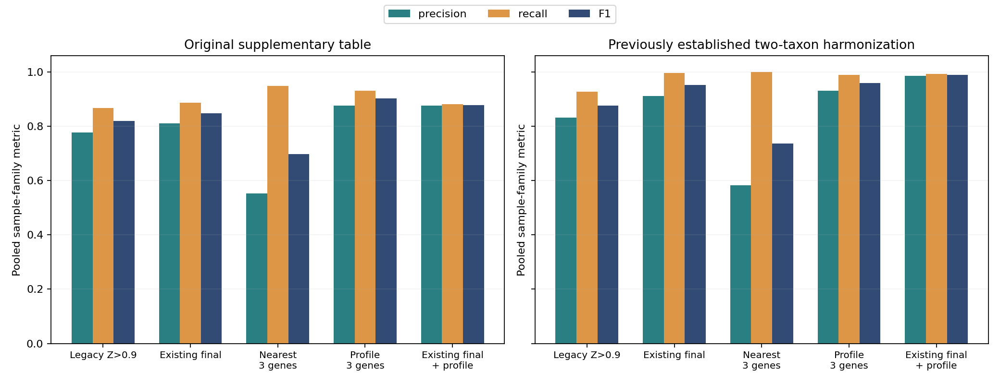
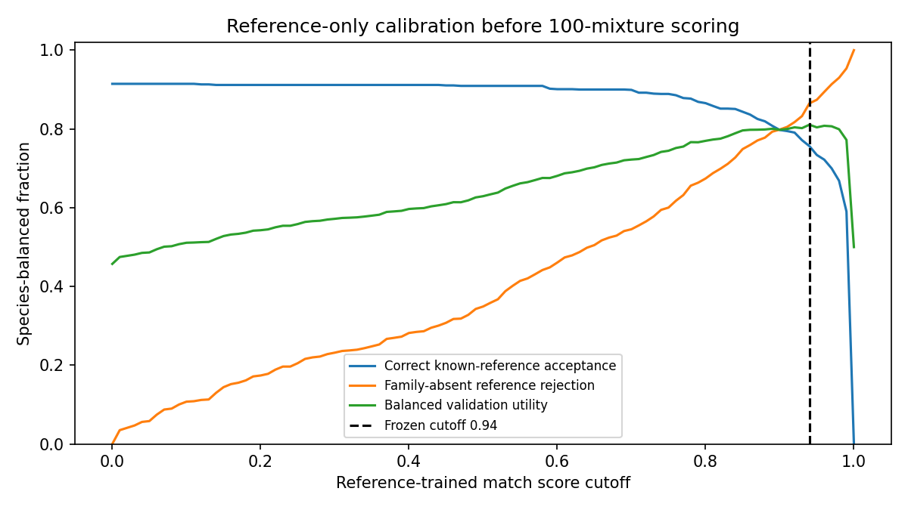

# 100 混样：reference full-profile 科级迭代

本轮完成 100/100、0 预测失败，复用现成的目预测和科树。原表主口径下，预先冻结的
独立新方法从既有最终方案的 precision **81.1% → 87.6%**、recall **88.7% → 93.0%**、
F1 **0.847 → 0.902**。以下保留全部预定方法及不利结果。

若按此前已确定的两处分类统一解释生物学结果，我更倾向把 ML 用作**原候选的确认层**：
precision **91.1% → 98.5%**，recall **99.6% → 99.2%**，F1 **0.952 → 0.989**，
完全匹配 **61/100 → 89/100**。代价是减少 44 个 sample-family 误报事件时，
额外丢失 2 个真阳性事件。确认组合是预先列出的对照，不能改称本轮预先指定的主方法。
这些结果支持继续研究这一组合，尚不构成新物种、新实验批次的独立验证。

100/100 预测完成后才在本地打开真表。复用相同目级候选、组装、科级参考、树拓扑和分支长度；未重新跑装配或更改已有预测。
这是同一批已评估样品上的回溯迭代，不能称为新的盲测。100 样品来自相同 30 个来源，包含 98 种组分组合。

预先冻结的主方法为 profile_gene3；其他方法保留作对照，不按本轮真值选择主方法。

| 口径 | 方法 | TP | FP | FN | Precision | Recall | F1 | NPV | MCC | 完全匹配 |
| --- | --- | ---: | ---: | ---: | ---: | ---: | ---: | ---: | ---: | ---: |
| table_literal | profile_gene3 | 495 | 70 | 37 | 87.6% | 93.0% | 0.902 | 99.9% | 0.901 | 45/100 |
| table_literal | nearest_gene3 | 504 | 408 | 28 | 55.3% | 94.7% | 0.698 | 99.9% | 0.719 | 8/100 |
| table_literal | profile_confirmed_baseline | 469 | 67 | 63 | 87.5% | 88.2% | 0.878 | 99.8% | 0.876 | 43/100 |
| table_literal | baseline_confirmed | 472 | 110 | 60 | 81.1% | 88.7% | 0.847 | 99.8% | 0.846 | 32/100 |
| table_literal | baseline_z09 | 461 | 132 | 71 | 77.7% | 86.7% | 0.820 | 99.8% | 0.818 | 25/100 |
| harmonized_two_taxa | profile_gene3 | 526 | 39 | 6 | 93.1% | 98.9% | 0.959 | 100.0% | 0.959 | 66/100 |
| harmonized_two_taxa | nearest_gene3 | 532 | 380 | 0 | 58.3% | 100.0% | 0.737 | 100.0% | 0.760 | 9/100 |
| harmonized_two_taxa | profile_confirmed_baseline | 528 | 8 | 4 | 98.5% | 99.2% | 0.989 | 100.0% | 0.989 | 89/100 |
| harmonized_two_taxa | baseline_confirmed | 530 | 52 | 2 | 91.1% | 99.6% | 0.952 | 100.0% | 0.952 | 61/100 |
| harmonized_two_taxa | baseline_z09 | 493 | 100 | 39 | 83.1% | 92.7% | 0.876 | 99.9% | 0.876 | 33/100 |

原表是主口径；辅助口径只沿用既有 1 号 Cabombaceae、25 号 Capparaceae 的分类统一，不修改原表。
NPV/TN 的固定全集为本批面板、预测及真表出现过的 362 个科；该全集有大量容易排除的阴性，NPV 不能单独代表识别能力。

## 方法和校准

每个基因只选一个确定性哈希最小的现成 exon tree，最多 64 个 reference pseudo-queries；不使用混样标签训练。
pseudo-query 的整个 species identity 从 anchors 移除。训练/校准 query species 按哈希分开；它们仍可能作为其他 pseudo-query 的已知 anchors，属于固定已知参考库上的 transfer 校准，不是前轮严格四分区的新物种评估。
特征包括最近和平均距离、同目竞争间距、去终端偏移的完整 reference 距离指纹残差/相关性/偏移，以及距离排序。family 采用均值而非参考数累加。
校准阈值为 0.940000，在固定 101 个 cutoffs 上最大化按 species 等权的已知正确接受/整科缺失拒识的平均效用。它是经验拒识阈值，不是物种存在概率或 FDR 保证。
已知 reference 留出 top-1 准确率 93.6%，阈值后的接受比例 79.2%。
主方法先用完整距离选每个片段的最近科，再用学习模型验证匹配，要求至少 3 个独立 gene 支持，不按 exon/contig 数累加；nearest_gene3 使用相同 gene 规则但不做模型验证；profile_confirmed_baseline 只保留原最终候选中至少 2 个 gene 获得模型支持者。

## 文件与限制

summary.csv 含全 100、98 组合去重和历史分组；by_sample.csv / by_family.csv.gz 给出每一处误报、漏检；coverage.csv 报告实际位点、树和父目覆盖。
所有方法使用同一批冻结树，预测后核对所有读取输入的 SHA-256、代码和模型，AUDIT.json 确认一致。
没有调整父目、人工增加真科、按预期组分数截断，或依据本轮结果调阈值。缺失父目、参考覆盖、旁系同源和 assembly 错误仍会限制结果。
模型只改变距离后的评分；本轮不证明建库或测序流水线的端到端提速，也不证明原来二维 pattern 已优于完整距离。
真表 SHA-256：`421cca29377ab01e57cb6aeded7bf446ba4faf06282120a4ed602e8c67bbb01f`。预测 protocol/model 的 SHA-256 与训练说明保存在 PROTOCOL.json 和 training.json。

## 改善与尚未解决的问题

独立新方法在原表上比既有最终方案增加 23 TP、减少 40 FP、减少 23 FN。
但这一增益不能直接等同于生物学分类更准确：辅助口径下，它仍有 31 次 Nymphaeaceae
误报，全部出现在含 1 号来源的样品中。该来源按已确定的辅助口径属于 Cabombaceae。
这说明单片段最近匹配与全局 profile 验证，仍可能把近缘科同时叫出，独立 gene 数
本身不能消除有系统性的跨科混淆。

确认组合在辅助口径下剩余 8 FP：Nymphaeaceae 4、Pittosporaceae 3、Paulowniaceae 1。
剩余 4 FN 中，2 次 Poaceae 已经存在于原候选结果；新增的 2 次均为 Caryophyllaceae：

| 样品 | nearest gene 票 | 通过 profile 验证的 gene 票 | 样品有效 gene |
| --- | ---: | ---: | ---: |
| 26x22x03x13x10x19x04x16x30x24 | 15 | 1 | 45 |
| 28x24x25x15x04x01 | 13 | 1 | 41 |

两例都有足够最近匹配证据，模型却只让一个 gene 通过阈值，低于预定的 2-gene 确认要求。
不能把它们解释为上游没有恢复该科。下一轮需要用独立 reference/query 校准材料研究
这类真匹配为何被拒绝，而不是为了这两份样品回调当前阈值。

原表下确认组合减少 43 FP、损失 3 TP；辅助口径下减少 44 FP、损失 2 TP。
两个口径都保留，避免用分类名统一掩盖真实的召回损失。
按 98 种组合去重，辅助口径确认组合 precision 98.49%、recall 99.24%、F1 0.989；
重复文件并非主要改善来源，但各组合仍共享相同 30 个植物来源和参考库。

## 校准、冻结和审计

训练与校准用作 pseudo-query 的 identity 分别为 602 和 140 个，两个查询集合不重合。
在这些参考库留出数据上，最初直接用二分类匹配分数给所有科排序的试验仅得到约 14.4%
top-1，因此在处理任何混样预测前就将它淘汰，改为最近候选的学习验证器。
这项选择只用了 reference 校准，不依据 100 个混样的真表调整。

100/100 使用相同模型和代码；6,339 棵既有有效树、6,839 份读取输入的哈希全部通过。
每个样品实际有 35–47 个有效 gene。独立 ZIP/XML 解析真表并直接重数候选名单后，
1,000 条 sample-method-view 记录和 40 条汇总全部一致，见 COUNT_AUDIT.json。
EVALUATOR_FREEZE.json 记录预测开始前固定的主评估器 SHA-256。

Slurm 运行资源调整及最终只读核对/打包记录在 RESOURCE_UPDATE.json；这些调整没有
改变任何科学参数、树、参考或模型。SLURM_ACCOUNTING.txt 保留计算作业记录，取消的
仅为排队中的收集作业；100 个预测作业全部完成。最终核对与文件打包已经成功完成。
大体积原始距离特征、逐片段表和模型留在 HPCC 本轮独立目录中；此目录版本化保存
predictions.json、压缩逐科计数、逐样品计数、校准和审计元数据，不包含 FASTQ 或序列。
